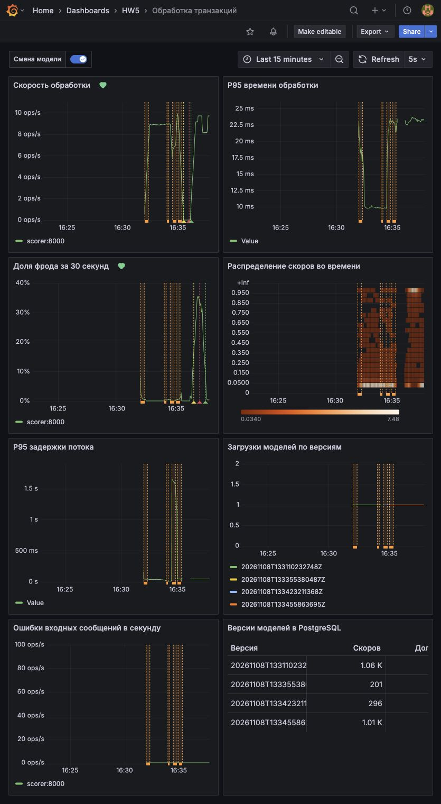
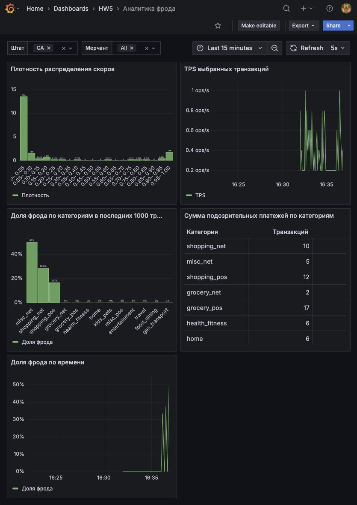
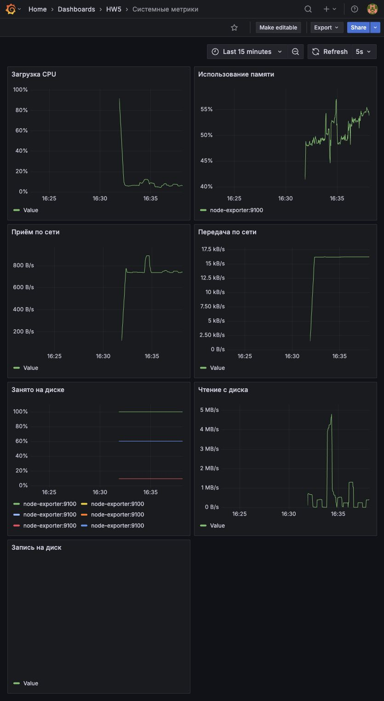
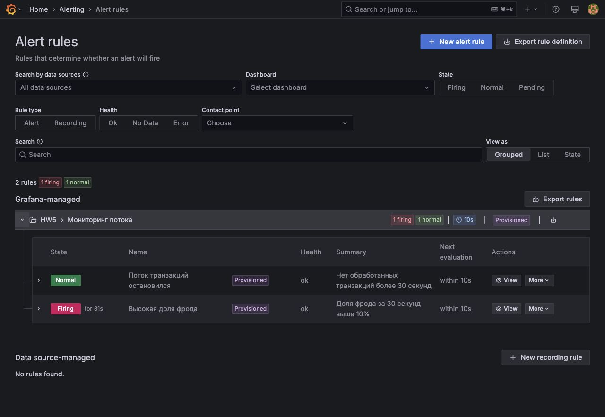

# Мониторинг антифрода

Kafka → CatBoost на CPU → Kafka → PostgreSQL. Prometheus собирает метрики раз в секунду, Grafana показывает поток, версии моделей и аналитику. Препроцессинг и контракт скоринга взяты из HW3, организация мониторинга — из [семинара](https://github.com/NikitaMalykhin/mlops_realtime_fraud_detector_monitoring). Конфигурация Prometheus, дашборды и алерты написаны отдельно.

## Запуск

Нужны Docker с Compose v2, Make, около 4 ГБ свободной памяти и свободные порты 3000, 9090, 8000 и 8001.

Нужно скачать **train.csv** из [соревнования teta-ml-1-2025](https://www.kaggle.com/competitions/teta-ml-1-2025/data). `test.csv` для этой работы не нужен.

```bash
git clone https://github.com/Ilya-Shn/il_shein_ml_ops_hw5.git
cd il_shein_ml_ops_hw5
mkdir -p data
```

Файл нужно положить в `data/train.csv`, затем выполнить:

```bash
make up
```

При первом запуске нужно дождаться скачивания образов и обучения первой модели. Все сервисы находятся в общей сети Compose. Симулятор непрерывно отправляет случайные строки исходного CSV примерно по 10 транзакций в секунду. Для каждого события создаются новый ID и время отправки; исходное время платежа сохраняется. Метка `target` в скоринг не передаётся.

- [Grafana](http://localhost:3000) — логин **admin**, пароль **admin**. При предложении сменить пароль можно нажать Skip.
- [Prometheus](http://localhost:9090) и [состояние источников](http://localhost:9090/targets) — без пароля.
- Метрики [скоринга](http://localhost:8000/metrics) и [записи](http://localhost:8001/metrics).

Источники, четыре дашборда в папке HW5 и два алерта подключаются автоматически. Для остановки используется `make down`; данные остаются в Docker volumes и `runtime/`. На macOS системные метрики относятся к Linux-машине Docker Desktop.

## Дашборды

| Дашборд | Что смотреть |
| --- | --- |
| [Обработка транзакций](http://localhost:3000/d/scoring) | TPS, P95 обработки, доля фрода, тепловая карта скоров, задержка потока, ошибки и загрузки моделей; таблица числа скоров и доли фрода по версиям из PostgreSQL |
| [Запись результатов](http://localhost:3000/d/writing) | Скорость и P95 записи, число скоров и случаев фрода, распределение скоров и доля фрода |
| [Системные метрики](http://localhost:3000/d/system) | CPU, память, приём и передача по сети, занятое место, чтение и запись на диск |
| [Аналитика фрода](http://localhost:3000/d/business) | Плотность скоров, TPS, доля фрода по категориям в последних 1000 транзакциях, суммы подозрительных платежей и доля фрода по времени |

На аналитическом дашборде сверху выбираются `Штат` (`us_state`) и `Мерчант` (`merch`). Можно выбрать несколько значений или All. Список мерчантов зависит от штатов. Фильтры действуют на все его панели. Плотность считается по интервалам шириной 0,05; сумма площадей столбцов равна 1. TPS считается по времени записи в пятисекундных интервалах. Для категорий сначала берутся последние 1000 записей всей таблицы, затем применяются фильтры; выбранный диапазон времени на эту панель не влияет.

Дополнительная бизнес-панель показывает суммы платежей с флагом фрода по категориям: она помогает оценить денежный объём подозрительных операций. Флаг равен 1 при `score > 0.98`, как в HW3. Доли на дашбордах относятся к предсказаниям модели.

## Метрики

| Метрики | Значение |
| --- | --- |
| `scorer_transactions_total`, `scorer_fraud_total` | Обработанные транзакции и предсказанный фрод |
| `scorer_processing_seconds` | Гистограмма времени обработки вместе с отправкой результата в Kafka |
| `scorer_score` | Гистограмма скоров |
| `scorer_fraud_ratio` | Доля фрода в последних 1000 обработанных транзакциях |
| `scorer_model_updates_total{version}`, `scorer_model_loaded_timestamp_seconds{version}` | Число загрузок и время загрузки версии модели, включая первую |
| `scorer_event_age_seconds` | Гистограмма задержки от отправки события до публикации скора |
| `scorer_errors_total` | Некорректные сообщения, отправленные в топик `errors` |
| `writer_scores_total`, `writer_fraud_total` | Число новых записей и записанных случаев фрода |
| `writer_insert_seconds`, `writer_score` | Гистограммы времени записи с COMMIT и записанных скоров |
| `node_cpu_seconds_total`, `node_memory_*`, `node_network_*`, `node_filesystem_*`, `node_disk_*` | Системные метрики Node Exporter |

У гистограмм есть серии `_bucket`, `_sum`, `_count`. Метрики обновляются на каждом успешном сообщении. Writer считает только новые строки; повторная доставка одного ID не создаёт дублей.

Новая относительно семинара метрика `scorer_event_age_seconds` показывает накопление очереди, даже если сам inference остаётся быстрым. Её P95 виден на графике «P95 задержки потока». `scorer_errors_total` помогает заметить некорректные сообщения.

## Проверка потока и новой модели

После минуты работы на графиках появляются TPS и распределения. Счётчики на страницах метрик растут. `make pause` останавливает отправку, `make resume` возобновляет её.

Trainer обучает CatBoost на трёх последовательных месяцах `train.csv`, сдвигает окно на месяц и публикует новую модель каждые пять минут после завершения обучения. После последнего окна цикл начинается заново. Для ручного переобучения:

```bash
make retrain
```

Команда выводит версию, месяцы и число строк обучения. Файл модели сохраняется до атомарного обновления `runtime/models/state.json`. На следующем сообщении скоринг подхватывает новую версию без перезапуска контейнера. На дашборде обработки появляется оранжевая отметка длительностью около 30 секунд; при наведении видна версия. Она также появляется в счётчике загрузок и таблице PostgreSQL. Для этой таблицы Grafana использует отдельного пользователя с правом SELECT.

## Алерты

Правила находятся в `grafana/provisioning/alerting/rules.json` и видны в [Alerting → Alert rules](http://localhost:3000/alerting/list). Проверяются каждые 10 секунд; условие должно сохраняться 30 секунд. Доставка сообщений не настраивается.

- **Поток транзакций остановился**: `rate(scorer_transactions_total[30s]) = 0`. Для проверки нужно выполнить `make pause` и подождать около 70 секунд после обработки очереди. Затем `make resume` возвращает состояние Normal.
- **Высокая доля фрода**: доля предсказанного фрода за 30 секунд выше 10%. `make fraud` запускает поток только из реальных строк с `target=1`. Через 1–2 минуты алерт переходит в Firing. `make normal` возвращает обычный поток, затем алерт становится Normal.

## Локальные проверки

```bash
make check
make scenarios
```

`make check` проверяет три источника Prometheus, рост счётчиков, запросы всех 26 панелей, SQL-фильтры, нормировку плотности, расчёт категорий и отсутствие дублей. `make scenarios` занимает несколько минут: запускает переобучение, проверяет горячую смену модели, срабатывание обоих алертов и восстановление обычного потока. Для него нужен Python 3.9+ на компьютере.

Использован полный `train.csv`: 786 431 строка. Результаты и SHA-256 файла находятся в [check.json](results/check.json), смена модели и состояния алертов — в [scenarios.json](results/scenarios.json).

## Примеры работы

Скорость потока, распределение скоров и оранжевые отметки загрузки новых моделей:



Аналитика с выбранным штатом CA:



Системные метрики Node Exporter:



Срабатывание алерта высокой доли фрода на реальных строках с `target=1`:


